# New-feature UX catalog

Captured from the uncommitted feature work on 2026-08-08 against a fresh local Matterhorn owner room. The catalog treats the current working tree versus `HEAD` as the new-feature boundary.

## Executive summary

The new work adds 14 distinct product areas across navigation, messaging, files/media, voice, community, safety, and integrations. The largest UX risk is not missing capability; it is density and hierarchy. The sidebar, composer, message menu, Community tab, Admin tab, and Integrations tab each accumulated several unrelated workflows without a strong information architecture pass.

Three surfaces are honestly capability-gated in the linked local runtime:

- Encrypted Files v2 uploads are disabled while the shared-session transport issue remains open.
- Cross-channel forwarding is hidden until authoritative source projection succeeds.
- Comment-thread creation is disabled when the accepted comments capability is absent.

The screenshots below preserve those states instead of mocking a successful path.

## Catalog

| Area | New feature and entry point | Captured state | UX treatment needed |
| --- | --- | --- | --- |
| Navigation | Encrypted search from **Find or start a conversation** | Six type filters plus author and date filters | The filter stack consumes most of the narrow sidebar. Establish progressive disclosure, a clear empty/loading state, and removable filter chips. |
| Navigation | Compact mode from **Compact** | Enabled message density | The control is visually tiny and its active state is easy to miss. Clarify whether this is a global display preference and expose the state more explicitly. |
| Productivity | **Bookmarks & reminders** plus message-menu actions | Empty and populated panels | Bookmarks and reminders are mixed into one narrow disclosure. Improve scanability, due-time language, and completed/read distinctions. |
| Direct messages | **Start group DM** and group management | Creation form with no eligible peers | The form can appear without participant choices and offers no explanatory empty state. Disable or hide creation until peers exist, or explain how to add them. |
| Message feed | **Load older messages**, cursor input, and **Jump to cursor** | Empty-room history toolbar | The raw cursor field is implementation-shaped. Replace with a user concept such as date/message link, or move this into an advanced history dialog. |
| Messages | Expanded reaction, reply, forwarding, thread, pin, productivity, unread, copy, edit, and delete actions | Full context menu | The menu is too long, mixes personal and shared actions, and can exceed a small viewport. Group actions, move destructive items, and explain disabled capabilities. |
| Threads | **Create Thread**, thread discussion, resolve/reopen | Capability-gated menu item | A disabled item without an explanation reads as broken. Add a reason or remove it when unavailable; when enabled, review the 36vh inline panel for long discussions. |
| Forwarding | DM/channel target picker and encrypted provenance | Capability-gated channel path | Channel targets must remain hidden until Matterhorn projection works. When enabled, clearly distinguish copying, referencing, and encrypted file re-sharing. |
| Attachments | **Attach**, **Drive**, **Advanced**, transfer progress, shared files | Files v2 unavailable; Drive still offered | The composer status wraps aggressively and crowds primary compose actions. Consolidate file entry points and move transport diagnostics out of the main action row. |
| Custom media | **Custom media** catalog, uploads, voice, storage, providers, consent | Inline catalog with type/storage controls | This is a large workflow embedded inside the composer. Use a focused modal/drawer, strengthen storage and consent hierarchy, and provide richer item previews. |
| Voice | Voice-room creation, stage/text binding, moderation, participant controls, screen-share watching | Management list and empty room | Empty rooms omit a clear join/connect action after navigation, and unbound text-channel copy dominates the header. Participant moderation is hidden in context menus and needs discoverability. |
| Community | Polls, events, RSVP/notifications, policies, channel kinds | Top of Community tab | Too many different jobs live in one long scroll. Split creation from ongoing content and separate channel policy administration from community participation. |
| Safety | Timeout, quarantine, slow mode, rules, reports, audit, AutoMod | Admin tab with self-targeted disabled actions | High-impact moderation controls sit adjacent without confirmation or hierarchy. Disabled self-actions need reasons. Separate policy, incident response, and member sanctions. |
| Integrations | Identity install, capabilities, secrets, encrypted events, commands, webhooks | Integration installation entry state | The capability string is implementation-facing and the full tab is extremely long. Introduce a guided install flow, human-readable permissions, and separate secrets/events/commands/webhooks. |

## Screenshots

### Room shell, history, and attachment gating

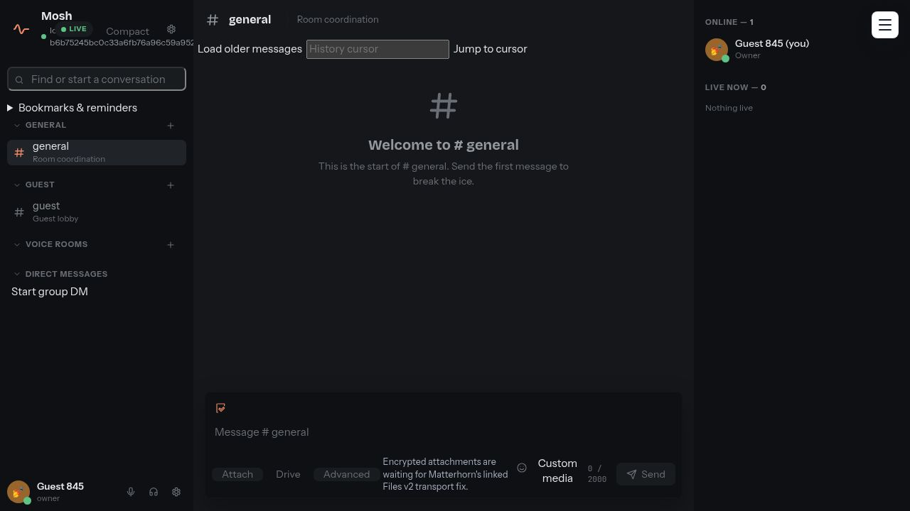

The shell already shows three hierarchy problems at once: advanced history controls sit above the message feed, attachment transport status occupies the composer, and the sidebar contains search, productivity, channel creation, voice, and DM creation.

### Encrypted search

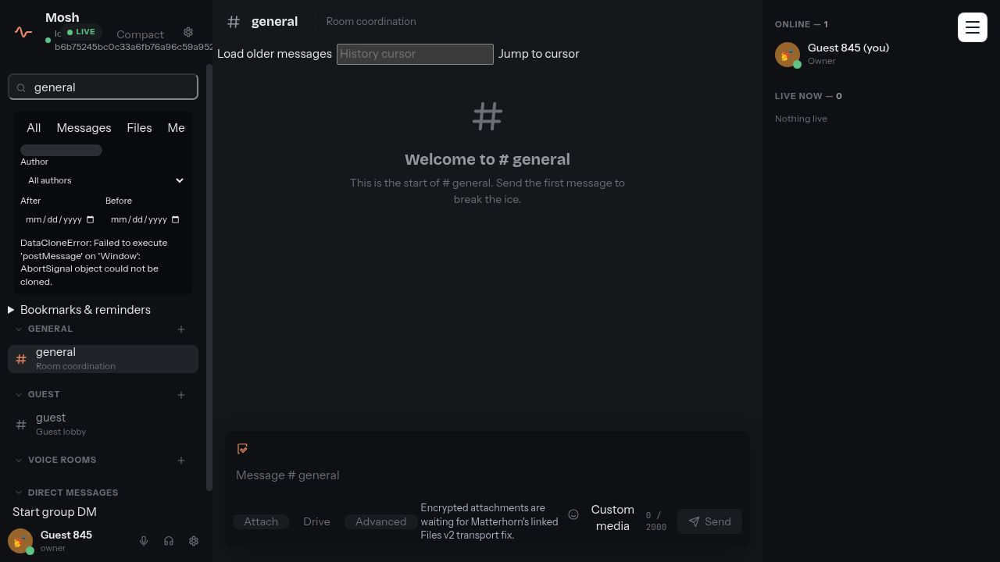

### Personal productivity

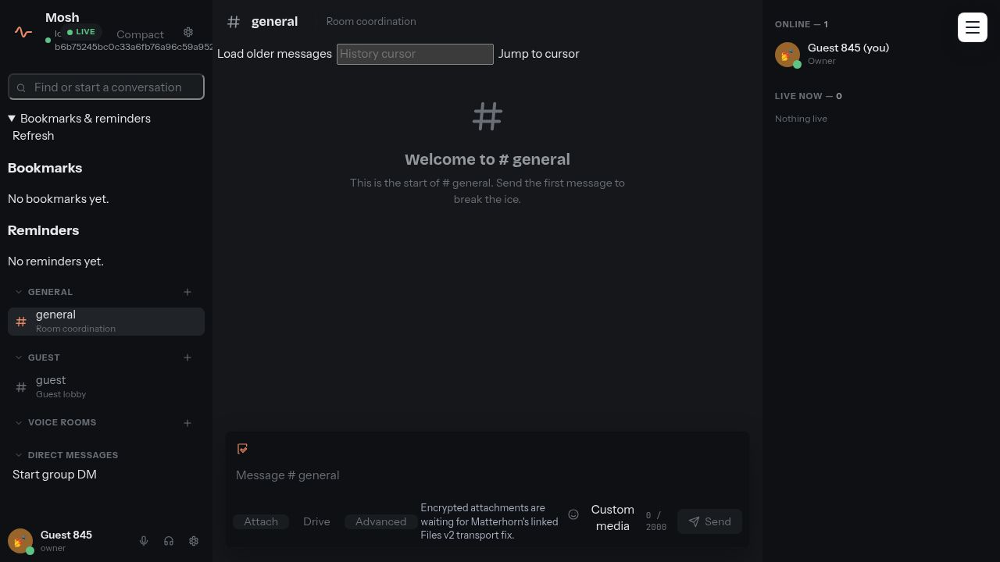

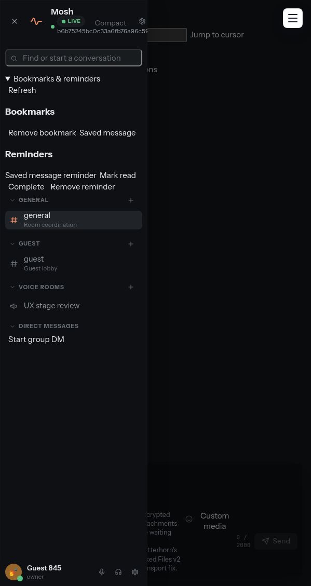

### Group direct messages

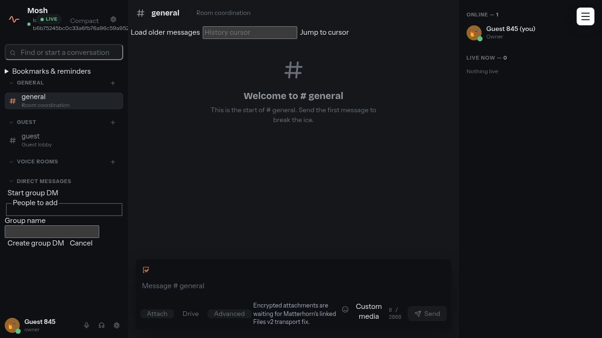

This fresh-room state is important: the creation UI opens even though there is nobody to select.

### Custom media

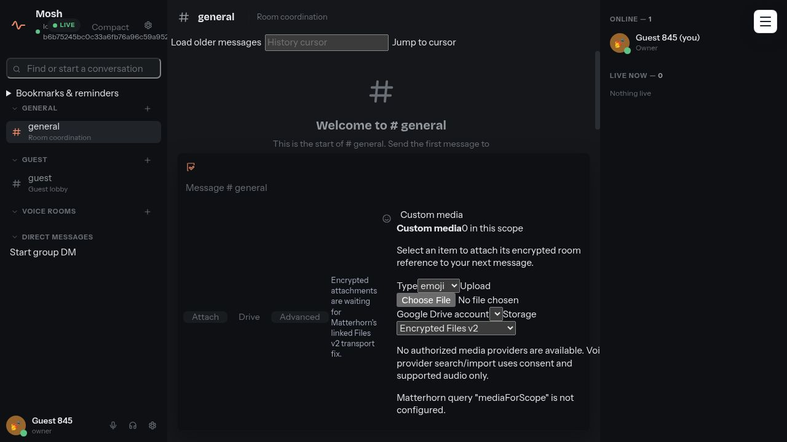

### Management information architecture

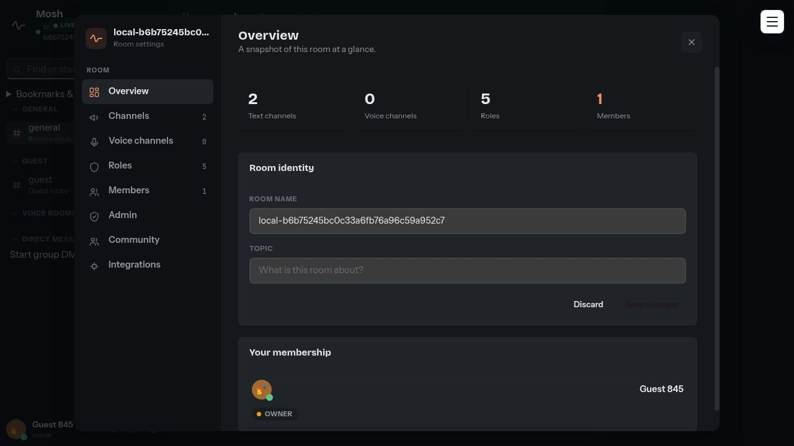

### Community tools

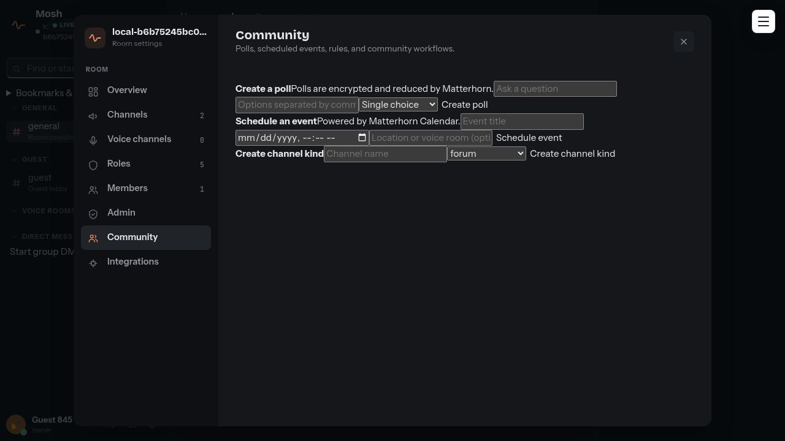

### Safety and moderation

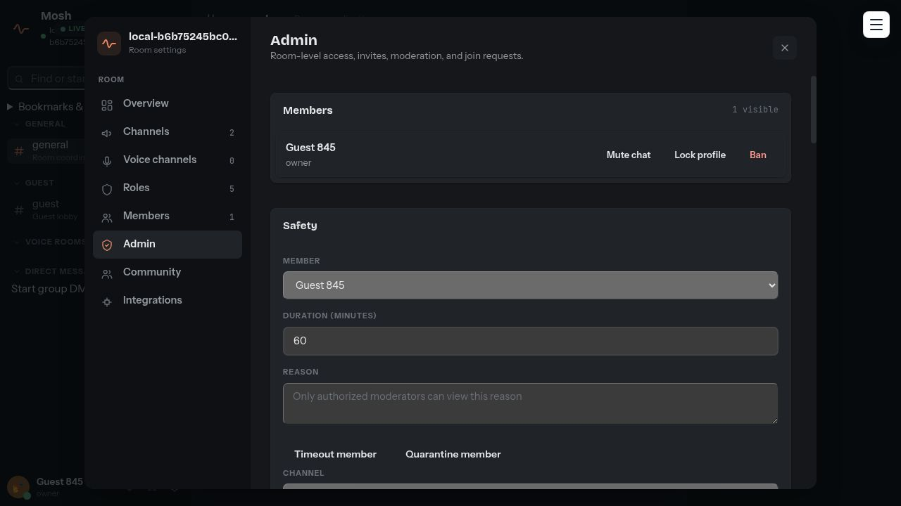

### Integrations

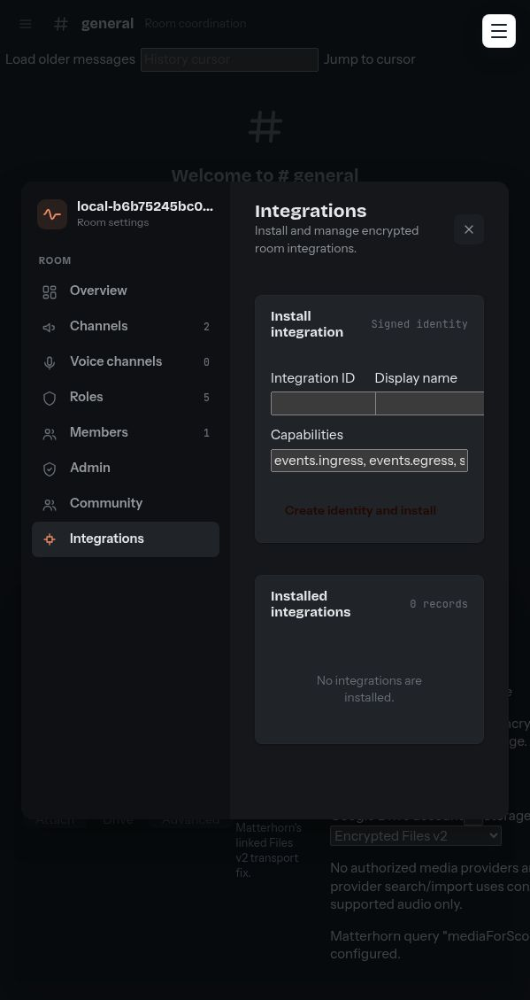

### Voice

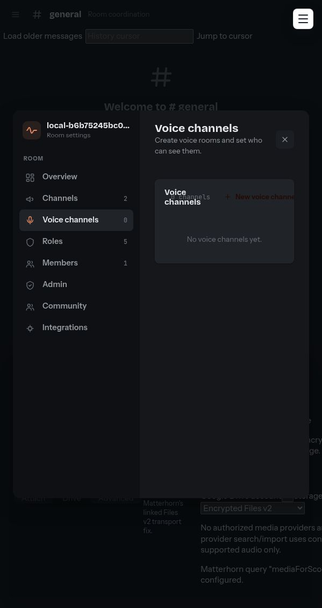

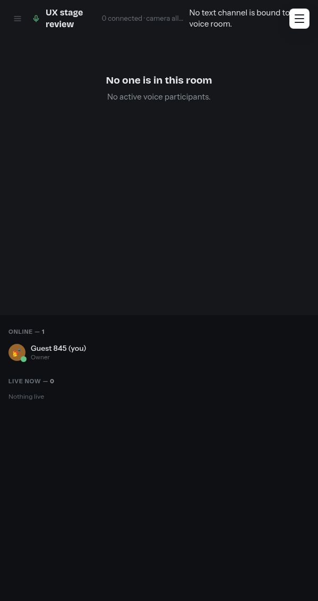

### Expanded message actions

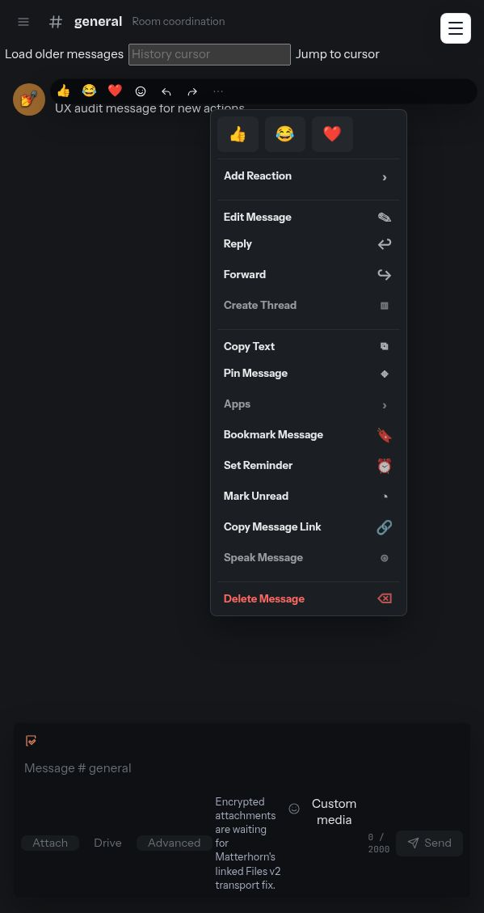

### Compact mode

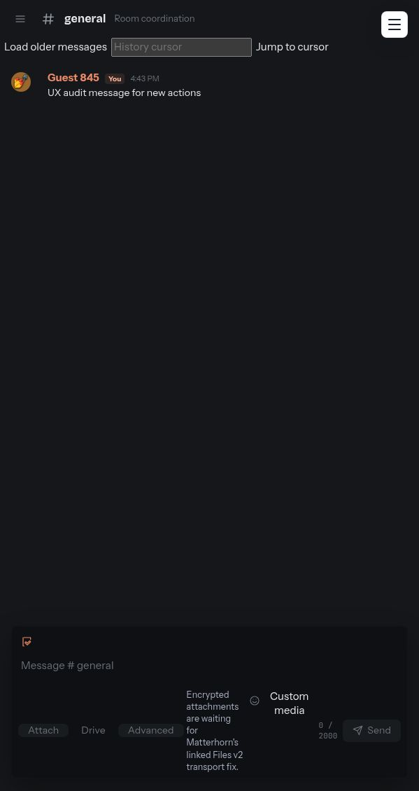

## Secondary states to include in a staffed multi-user review

These features are cataloged from the implementation and browser specs but require multiple isolated identities, linked provider accounts, or a resolved Matterhorn capability before a truthful success-state screenshot can be captured:

- Group-DM rename, add/remove member, leave, close, and restored-thread states.
- Direct-message reaction, pin/unpin, forwarding, and direct-call invite/accept/end.
- Successful Files v2 upload/download, advanced picker folder browsing, attachment-only send, and cross-scope file forwarding provenance.
- Google Drive account/folder selection and explicit consent-denial recovery.
- Comment-thread create/reply/resolve/reopen.
- Successful cross-channel forwarding and forwarded-source provenance.
- Stage open/close, request/approve/remove speaker, participant mute/deafen/suppress/kick, camera, and screen-share watch states.
- Poll voting/closing, event RSVP, calendar notifications, and channel-policy editing after records exist.
- Report inbox, moderation audit, room-rule acceptance/publishing, AutoMod evaluation, and flagged-message review.
- Installed integration selection, secret rotation, encrypted event ingress/egress, command lifecycle, and webhook policy editing.
- Admin member mute/profile-lock/ban and invite disable/remove with non-self members present.

## Suggested UX work order

1. Fix the core shell and composer hierarchy: history, attachment entry points, custom media, and narrow-width behavior.
2. Redesign the message action architecture and personal productivity relationship.
3. Split Community, Safety/AutoMod, and Integrations into task-focused sub-surfaces.
4. Run a dedicated multi-user voice/DM moderation review once the linked capability gates are available.
